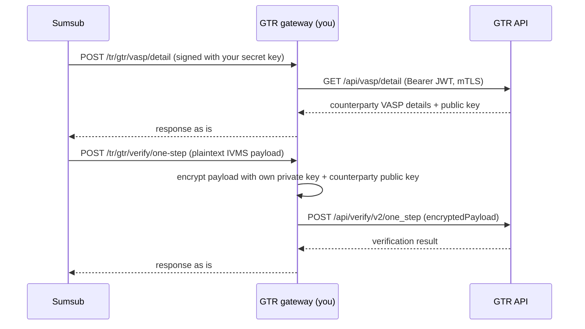

# GTR gateway

> Sumsub publishes this contract, the libraries and the examples so that a VASP can build its own GTR
> gateway quickly and correctly. The libraries receive security fixes; the examples are reference code
> that you review, build and operate yourself. See [Disclaimer](#disclaimer).

A **GTR gateway** is a small HTTP service that a VASP hosts in its own infrastructure to connect its
Sumsub Travel Rule integration to the [Global Travel Rule (GTR)](https://www.globaltravelrule.com/)
network.

Sumsub keeps all Travel Rule business logic — building IVMS 101 payloads, matching, rules, statuses,
the dashboard. The gateway does only what cannot be done outside the VASP's perimeter:

- it authenticates to GTR with the **VASP's own credentials** (API key, mutual-TLS certificate);
- it **encrypts PII payloads** with the VASP's own Ed25519 key, so private keys never leave the VASP;
- it makes the calls to GTR **from the VASP's own IP addresses**.

Everything else is a pass-through: the gateway receives a signed request from Sumsub, forwards it to
GTR and returns the GTR response unchanged.

## Contents

- [How it works](#how-it-works)
- [Quick start](#quick-start)
- [Deploy without writing code](#deploy-without-writing-code)
- [The contract](#the-contract)
- [Examples](#examples)
- [Environments](#environments)
- [Going live](#going-live)
- [Security model](#security-model)
- [Repository layout](#repository-layout)
- [Support](#support)
- [Disclaimer](#disclaimer)
- [License](#license)

## How it works



For every outgoing Travel Rule transfer Sumsub calls the gateway a few times: to fetch the
counterparty's current public key, to confirm which VASP owns the beneficiary address, to submit the
transfer with the encrypted PII and, after settlement, to report the on-chain transaction hash. The
gateway keeps no Travel Rule state between calls; the only thing it holds is the GTR session token.

## Quick start

You need Docker with Compose; `make e2e` also uses `make`, `bash`, `curl` and `openssl`, plus `gpg` for
the payload-encryption checks, which it skips when gpg is missing. On Windows run it from WSL. Running
from source takes Node.js 22.12+ or Go 1.26+.

1. **Pick an example** in the language closest to your stack: [TypeScript](examples/typescript/) or
   [Go](examples/go/). Each has its own README with run instructions. To embed the gateway into a
   service you already run, add the [library](#libraries) instead and keep the example as the pattern.
2. **Run it against the mock GTR** shipped in `examples/typescript/mock/` — no GTR credentials needed.
   The mock enforces mutual TLS and the login handshake and decrypts the PII you send, so you see the
   whole chain working. The quickest way is Docker Compose, which builds the mock and both gateways:

   ```bash
   make e2e        # builds the mock and both gateways, then drives signed requests through each
   make e2e-down   # stop and clean up
   ```

   The mock runs on :9443 and the gateways on :8787 (TypeScript) and :8789 (Go).

   Without Docker, `make e2e-local` runs the same checks with the mock and both gateways as local
   processes; it needs Node.js and Go. To work with one example by hand, see "Try it without GTR
   credentials" in its README.
3. **Point Sumsub at it.** Sumsub must reach the gateway on a public HTTPS URL; `localhost`, private
   addresses and plain `http` are rejected in Sandbox as well as in production, so deploy it or, for a
   first try, expose the port with a tunnel such as ngrok or cloudflared. Then open *Marketplace →
   Global Travel Rule → Settings* in the Sumsub dashboard, enter your GTR VASP code, the five endpoint
   URLs and the secret key, and press **Test connection**.
4. **Switch to real GTR credentials** when you are ready — see [Going live](#going-live).

## Deploy without writing code

Each example is a finished gateway, configured only through environment variables, with a
`compose.yaml` that builds the image from this repository and runs it. Nothing to implement:

```bash
git clone https://github.com/sumsub/gtr-gateway.git && cd gtr-gateway/examples/go   # or examples/typescript
cp .env.example .env                                           # fill in the values, see below
mkdir -p secrets && cp /path/to/certificate.p12 secrets/        # the mutual-TLS certificate from GTR
docker compose up -d --build
curl -s localhost:8080/health
```

`.env` takes the GTR credentials (`GTR_VASP_CODE`, `GTR_ACCESS_KEY`, `GTR_SECRET_KEY`, the certificate
password, the base64 Ed25519 private key), the secret key you enter in the Sumsub dashboard and,
for incoming Travel Rule requests, the Sumsub API token from *Marketplace → GTR → Generate API token*.
Every variable is explained in the file, and each one can be read from a file instead through
`NAME_FILE`, which suits Docker and Kubernetes secrets. The container publishes port 8080 on
`127.0.0.1` only: put a reverse proxy with TLS in front of it, restrict `/tr/gtr/callback` to GTR's client
certificate as shown in the [security guide](docs/security.md#the-callback-endpoint), enter the resulting
URLs in the dashboard and press **Test connection**. `docker compose logs -f` shows every call with its
status. To update, pull the repository and run `docker compose up -d --build` again.

Sumsub does not publish prebuilt images: the image is built on your side from code you can read, and
you own it like any other service you run. The root `compose.yaml` is different — it is the test stand
with the mock GTR from [Quick start](#quick-start), not a deployment.

## The contract

Sumsub calls five endpoints with `POST` and a JSON body. Every request carries `X-Payload-Timestamp` and
`X-Payload-Digest`, an HMAC of the timestamp and the raw body keyed with the secret key configured in the
Sumsub dashboard, and a gateway rejects requests more than five minutes old. Optionally the body is also
PGP-encrypted to your key and signed by Sumsub (contract §2.1); the examples decrypt it when
`GATEWAY_PGP_PRIVATE_KEY` is set. Responses are returned in plaintext: they carry no personal data.

| Gateway endpoint | Forwards to GTR | Gateway logic |
|---|---|---|
| `POST /tr/gtr/vasp/detail` | `GET /api/vasp/detail` | none |
| `POST /tr/gtr/verify/auto-address-vasp-detection` | `POST /api/verify/v2/auto_address_vasp_detection` | none |
| `POST /tr/gtr/verify/one-step` | `POST /api/verify/v2/one_step` | encrypt `payload` → `encryptedPayload` |
| `POST /tr/gtr/verify/tx/submit` | `POST /api/verify/tx/submit` | none |
| `POST /tr/gtr/verify/end` | `POST /api/verify/v2/end` | none |

The full specification is [docs/gateway-contract.md](docs/gateway-contract.md) (contract version 1.0)
with a machine-readable [OpenAPI document](docs/openapi/gtr-gateway.openapi.yaml). Changes to the
contract that affect an existing gateway are recorded in the
[contract changelog](docs/CHANGELOG.md).

## Examples

Each example is a complete, runnable gateway that implements the contract above. They are
deliberately thin: the behaviour lives in the libraries below, and an example is the configuration and
HTTP wiring around them, so switching between them or porting the wiring to your own service is easy.

Beyond the five endpoints above, each gateway also serves the inbound GTR callback (§6 of the
contract) and a `GET /health` check.

| Language | Stack | Status |
|---|---|---|
| [TypeScript](examples/typescript/) | Node.js 22.12+, Fastify, built on the [TypeScript library](typescript/) | ready |
| [Go](examples/go/) | Go 1.26+, net/http, built on the [Go library](go/) | ready |

Both libraries pass the shared test vectors: [request-signature.json](test-vectors/request-signature.json)
for the request signature, [crypto-box.json](test-vectors/crypto-box.json) for the GTR PII envelope and
[pgp.json](test-vectors/pgp.json) for the optional request encryption. An implementation that reproduces
every digest and signature and decrypts every vector to its payload is byte-compatible with the network.
Add the vectors to your own test suite if you port the code.

### Libraries

The building blocks of the examples are also published as libraries, so you can build a gateway into
your own service instead of running the example as is:

| Library | Install | Entry point |
|---|---|---|
| Go — [`github.com/sumsub/gtr-gateway/go`](go/) | `go get github.com/sumsub/gtr-gateway/go` | `gateway.NewHandler` returns an `http.Handler`; signature verification, PGP decryption, the GTR client and the PII envelope are exported separately |
| TypeScript — [`@sumsub/gtr-gateway`](typescript/) | `npm install @sumsub/gtr-gateway` | `createGateway` returns a framework-agnostic `handle(request)`; `createNodeHandler` and `createFetchHandler` mount it on Express, NestJS, Next.js and the like; the building blocks are exported separately |

Both examples are wiring on top of their libraries. Other languages can run either example as a
container: the gateway is configured entirely through environment variables.

## Environments

Run one gateway per Sumsub environment, each with its own credentials:

| Sumsub | GTR | `GTR_API_URL` |
|---|---|---|
| Sandbox | UAT | `https://uat-platform.globaltravelrule.com` |
| Production | production | `https://platform.globaltravelrule.com` |

The two gateways share nothing. GTR issues separate API keys and certificates for UAT and production,
and each GTR environment has its own callback URL in the GTR portal. Each Sumsub environment has its own
GTR card, so the secret key, the PGP key and the API token differ as well.

## Going live

1. **Onboard with GTR.** GTR issues an API key file (`vaspCode`, `accessKey`, `secretKey`), a
   mutual-TLS client certificate (`certificate.p12`) and registers the Ed25519 public key your gateway
   encrypts PII with. Keep all of them in your secret store; the examples read them from environment
   variables and files at start-up.
2. **Deploy the gateway** behind TLS, reachable from Sumsub, either from the
   [compose file](#deploy-without-writing-code) of an example or from your own service built on a
   library. Restrict `/tr/gtr/callback` to GTR's client certificate and keep the clock synchronised with
   NTP; the [security guide](docs/security.md) has the details and a deployment checklist.
3. **Configure Sumsub**: *Marketplace → Global Travel Rule → Settings* — GTR VASP code, endpoint URLs,
   secret key, signature algorithm and any static headers your perimeter needs. **Test connection**
   resolves your own VASP through the gateway and confirms both the signature and the GTR credentials.
   To also encrypt the request bodies, [generate a PGP key pair](docs/security.md#pgp-keys), upload the
   public key in the same card and put the private key into `GATEWAY_PGP_PRIVATE_KEY`. Copy the Sumsub
   public key shown next to it into `SUMSUB_PGP_PUBLIC_KEY` and switch on **Encrypt requests**.
4. **Monitor**: the examples log method, path, status and duration for every request — never bodies,
   which contain personal data. Sumsub shows the status of every gateway call in the Travel Rule details
   of a transaction.

## Security model

| Secret | Lives | Used for |
|---|---|---|
| Sumsub secret key | Sumsub dashboard and gateway config | verifying that a request comes from Sumsub |
| GTR API key, `certificate.p12` | gateway only | authenticating to GTR |
| Ed25519 private key | gateway only | encrypting PII for the counterparty VASP |
| PGP private key (optional) | gateway only | decrypting the requests Sumsub encrypts to the matching public key |

Sumsub never holds your GTR credentials or keys; the gateway never holds Sumsub credentials. Requests
from Sumsub are authenticated with an HMAC over a timestamp and the raw body (§2 of the contract) and,
when enabled, PGP-encrypted and signed (§2.1); PII travels to GTR as a NaCl `crypto_box` envelope (§4).
GTR callbacks are authenticated only by GTR's client certificate, which your TLS terminator must verify.
The [security guide](docs/security.md) covers that, rotating every secret without downtime and a
deployment checklist.

## Repository layout

```
docs/                      contract specification, OpenAPI document, security guide and contract changelog
go/                        Go library github.com/sumsub/gtr-gateway/go, released as tags go/vX.Y.Z
typescript/                TypeScript library @sumsub/gtr-gateway, released as tags typescript/vX.Y.Z
package.json               npm workspace root for the TypeScript library and example
examples/<language>/       one gateway per language; Go and TypeScript build on the libraries
examples/typescript/mock/  mock GTR server and throwaway PKI for local testing
examples/<language>/compose.yaml  one-command deployment of that example
compose.yaml, scripts/     local end-to-end stand (mock + gateways) and its smoke test
test-vectors/              shared cryptographic test vectors
```

## Support

- Questions about the Sumsub side of the integration go to your Sumsub account manager or
  [Sumsub support](https://support.sumsub.com/).
- Found a bug in an example, or something wrong in the contract? Tell your Sumsub contact — this
  repository is maintained by Sumsub and does not take outside contributions.
- Security vulnerabilities: report them privately as described in [SECURITY.md](SECURITY.md).

To check an example after you change it:

```bash
npm ci && npm run lint && npm run typecheck && npm test && npm run build
cd go                  && test -z "$(gofmt -l .)" && go vet ./... && go test ./...
cd examples/go         && test -z "$(gofmt -l .)" && go vet ./... && go build ./...
```

`make test` runs both; `make e2e` drives the whole chain against the mock GTR.

## Disclaimer

The libraries follow semantic versioning and receive security fixes in their latest minor version, as
described in [SECURITY.md](SECURITY.md). The examples, the Dockerfiles and the compose files are reference
implementations: review them, adapt them to your security requirements and infrastructure, and run them
at your own risk. Sumsub does not publish prebuilt container images of the gateway. Never commit real GTR
credentials, certificates or private keys to a repository.

## License

[MIT](LICENSE). Copy the code into your own gateway freely; keep the copyright notice.
